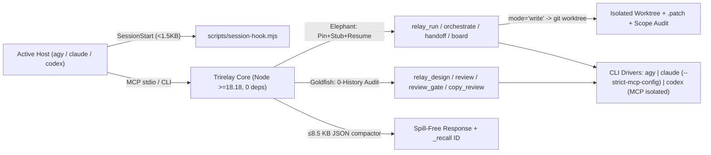

<div align="center">


# Trirelay

**Host-Symmetric Multi-Agent Orchestration Relay for Antigravity (`agy`), Claude Code (`claude`), and OpenAI Codex (`codex`)**

[](#quick-start)
[](#architecture)
[](#platform--compatibility-notes)
[](LICENSE)

English · [简体中文](README.zh-CN.md) · [Quick Start](#quick-start) · [Benchmarks](#benchmarks) · [MCP & CLI Reference](#mcp--cli-reference) · [Changelog](CHANGELOG.md)

</div>

<br />

**Trirelay** (`trirelay`) is a zero-dependency local MCP server, CLI, and shared Skill bundle that connects **Google Antigravity (`agy`)**, **Claude Code (`claude`)**, and **OpenAI Codex (`codex`)** symmetrically. Whichever agent hosts your session acts as coordinator for **trackable, resumable, and verifiable multi-turn cross-agent handoffs**—isolating write edits in worktrees, inheriting explicit constraints across stages, bounding MCP payloads, and blocking recursive CLI loops.

| Tiered Board Memory *(v1.1.0 offline)* | Cross-Engine Continuity *(v1.1.0 offline)* | MCP Inline Payload Cap *(v1.1.0 offline)* | SessionStart Hook *(v1.1.0 offline)* |
| :---: | :---: | :---: | :---: |
| **-48.4%**<br><sub>`6,405 B → 3,305 B` · `5/5` pins intact</sub> | **100% prefix + chain**<br><sub>`373 B` byte-0 prefix · cross-stage invariants intact</sub> | **-96.4% / -98.5%**<br><sub>`1,018 B` job / `917 B` review (`≤8.8 KB` threshold + `blockingPreview`)</sub> | **623 ms median** *(462 B)*<br><sub>Git + roles + handoff + pins/stubs</sub> |

---

## Why Trirelay?

Most multi-agent bridges either lock one tool in as permanent boss, bloat prompts with raw chat history (hurting cost and latency), or write unguarded edits directly into your working tree. Trirelay stays **small, practical, and zero-dependency**:

1. **True 3-Way Host Symmetry (6 Directed Paths)**
   - From **Antigravity**: delegates to `claude` & `codex`
   - From **Claude Code**: delegates to `agy` & `codex`
   - From **OpenAI Codex**: delegates to `agy` & `claude`
   Role routing (`advisor`, `implementer`, `reviewer`) excludes the active host automatically, strips nested host env vars (`CLAUDECODE`, `ANTIGRAVITY_*`, etc.), and enforces `TRIRELAY_DEPTH` recursion guards.
2. **Elephant vs. Goldfish Context Routing**
   - **Elephant (Trackable Continuity)**: Implementation & multi-turn roles receive **byte-0 prefix-stable** `<HANDOFF_PACKET>` files (`<HANDOFF_CONTRACT>` + pinned invariants before the turn delimiter), **3-tier board views** (*dedicated `.pins.json` active-pin index → 120-char programmatic Stub → explicit omission warnings + paginated/full recall*, zero extra LLM summary calls), chained constraint inheritance (`invariants`, `decisionsMade`, `doNotRelitigate`, `forbiddenFiles`) across pipeline stages, and worktree-bound `resumeRole: true` sessions.
   - **Goldfish (Zero-Context Audit)**: `relay_review`, `relay_review_gate`, and `relay_design(action="start")` run with **0 prior chat history** and **no author defense**—eliminating anchoring bias while cutting input tokens.
3. **Process & Scope Guardrails**
   - **Worktree-Isolated Writes (`mode: "write"`) + Resumable Snapshots**: Write workers run inside isolated `git worktree` checkouts, capture uncommitted edits, untracked files, binary diffs, and detached-HEAD commits into per-job `.patch` artifacts with SHA-256 hashes (reporting `deliverableMode: "patch" | "ignored-only" | "none"`), audit `ownedFiles`/`forbiddenFiles` (`--no-renames` source+target, re-audited on `relay_apply`), and hold edits out of your main tree until `relay_apply(mode="apply")`. Resuming a write session (`resumeRole: true`) rebinds the original worktree (or replays its SHA-256-verified `.patch` onto `baseSha`) and fails closed if unrecoverable.
   - **Per-Engine Execution Profiles**: Drivers enforce distinct engine tool rules—`claude` in `mode: "write"` restricts allowed tools and disables `Bash` (`--disallowedTools Bash`), so it edits files directly without running shell commands/tests; `codex` runs with `workspace-write` sandbox isolation; `agy` runs with `--mode accept-edits` (no `--sandbox`) in write mode and `--mode plan --sandbox` in readonly mode.
   - **Write-Once Review Artifacts & Bounded Cycle Gate (`relay_review` / `relay_review_gate`)**: Dual-engine reviews persist full findings as write-once `reviewId` artifacts with zero-cost paginated inspection (`action: "inspect"`), preserve `blockingPreview[]` (`id`, `file`, `line`, `title`, `trigger`) under the `8.5 KB` inline MCP cap, separate `blocking` defects from `advisory` notes, upgrade sensitive paths (`auth`, `billing`, `credentials`, `deploy`, `persistence`, `eval`) to `xhigh`, and manage cycle lifecycles cleanly (`open` -> `passed` -> new cycle) with `cycleId` compare-and-set and escalation on round 3+.
   - **Sealed Dual-Track Design (`relay_design`)**: Keeps the host draft hashed & sealed until the independent advisor finishes, then reveals both with a 4-section merge template.
   - **Spill-Free Bounded Async MCP**: `background: true` + `relay_jobs` avoids 3-minute MCP RPC timeouts; responses over `8.5 KB` compact deterministically with actionable `_recall` pointers (and `allowUnboundedRecall` for explicit `inspect`/`pinsOnly`/`seqs`/`view="full"` requests).

---

## Architecture



---

## Quick Start

### Prerequisites

- **Node.js** `>= 18.18.0` (Linux or macOS)
- **Git** (required for isolated write worktrees and diff reviews)
- At least two locally installed and authenticated CLIs: `agy`, `claude`, and/or `codex`

### Install

```bash
git clone https://github.com/Jacknegar/Trirelay.git
cd Trirelay

# 1. Check detected CLIs & auth readiness
node ./bin/trirelay.mjs doctor --json

# 2. Preview host registrations (dry-run by default; never overwrites CLAUDE.md/CODEX.md/GEMINI.md)
./scripts/install.sh --dry-run

# 3. Apply symlinks / MCP registrations for Antigravity, Claude Code, and Codex
./scripts/install.sh --apply
```

For **Claude Code 2.1.275+** marketplace installs:
```text
/plugin install trirelay --marketplace Jacknegar/Trirelay
```

### Per-Host Integration Matrix

| Host | Manifest / Config Included | Skills & Hook Integration |
|---|---|---|
| **Antigravity (`agy`)** | [`plugin.json`](plugin.json), [`mcp_config.json`](mcp_config.json) (7 eager core tools), [`hooks.json`](hooks.json), [`rules/AGENTS.md`](rules/AGENTS.md), [`agents/*.md`](agents) | [`skills/*/SKILL.md`](skills/trirelay/SKILL.md), `SessionStart` `injectSteps` |
| **Claude Code (`claude`)** | [`.claude-plugin/plugin.json`](.claude-plugin/plugin.json), [`.mcp.json`](.mcp.json), [`hooks/hooks.json`](hooks/hooks.json) | `skills/*/SKILL.md`, `claude mcp add --scope user trirelay`, `SessionStart` `additionalContext` |
| **OpenAI Codex (`codex`)** | [`.codex-plugin/plugin.json`](.codex-plugin/plugin.json), [`.mcp.json`](.mcp.json) | `~/.codex/skills/*`, `codex mcp add trirelay` |

> **Optional User Rule**: Review [`docs/collaboration-snippet.md`](docs/collaboration-snippet.md) and manually add it to `~/.claude/CLAUDE.md`, `~/.codex/CODEX.md`, or `~/.gemini/GEMINI.md` if desired. Trirelay never mutates global prompt files automatically.

---

## MCP & CLI Reference

Every core workflow has matching CLI commands (`./bin/trirelay.mjs <subcommand>`, including `--parent-handoff`, `--decision`, `--do-not-relitigate`, `--supersede`, `--deprecate-invariant`, and `--timeout`), while fine-grained JSON schema options live on the MCP surface:

| MCP Tool | CLI Equivalent | Purpose |
|---|---|---|
| `relay_setup` | `trirelay doctor` | Inspect `agy`, `claude`, `codex` readiness & host context |
| `relay_models` | `trirelay models` | Live model catalog, aliases & role profiles |
| `relay_route` | `trirelay route` | Preview host-aware role routing (`excludeHost: true`) |
| `relay_run` | `trirelay run` | Scoped worker execution (`mode="readonly"\|"write"`, `background`, `resumeRole`) |
| `relay_review` | `trirelay review` | Goldfish single or parallel cross-engine diff review |
| `relay_review_gate` | `trirelay review-gate` | Bounded 2-round blocking/advisory gate (`xhigh` on sensitive paths) |
| `relay_design` | `trirelay design` | Sealed dual-track architecture design (`start` / `submit-host` / `reveal`) |
| `relay_copy_review` | `trirelay copy-review` | Structured `location \| current \| problem \| suggestion` copy audit |
| `relay_orchestrate` | `trirelay teamwork\|boost\|swarm\|pipeline` | Multi-worker DAG/fan-out workflows with worktree isolation |
| `relay_apply` | `trirelay apply` | `git apply --check` / `git apply` for captured worktree patches |
| `relay_handoff` | `trirelay handoff` | Create/inspect prefix-ordered `<HANDOFF_PACKET>` artifacts |
| `relay_board` | `trirelay board` | Process-locked JSONL board (3-tier Pin/Stub/Recall by default, `view="full"` recall) |
| `relay_jobs` | `trirelay jobs` | `list` / `status` / `wait` / `result` (`compact=false` for raw output) / `cancel` |

### Environment Controls

- `TRIRELAY_AGY_BIN` / `TRIRELAY_CLAUDE_BIN` / `TRIRELAY_CODEX_BIN` / `TRIRELAY_NODE_BIN`: explicit binary overrides.
- `TRIRELAY_CODEX_MCP_ALLOW`: comma-separated Codex MCP server names to keep enabled for workers (by default, headless Codex workers disable configured `[mcp_servers.*]` via `-c` overrides to skip unrelated OAuth/remote MCP startup).
- `TRIRELAY_CODEX_KEEP_MCP=1`: keep all non-Trirelay Codex MCP servers enabled (`trirelay`/`trimesh` always remain disabled inside workers to prevent recursion).
- `TRIRELAY_MCP_MAX_BYTES`: MCP inline cap in bytes (default `8500`, clamped to `1024..65536`).
- `TRIRELAY_ALLOWED_ROOTS`: optional path-delimiter-separated allowlist restricting workspace paths.

---

## Benchmarks

Offline metrics (`v1.1.0`) were generated locally using `npm run benchmark` (`scripts/benchmark.mjs`, `Node.js v24.15.0`); payload byte checks are deterministic, while hook latencies reflect wall-clock spawns. Historical live rows below are **single-run `v1.0.0` observations** recorded locally on Linux x64 (`Node.js v24.15.0`, `claude 2.1.325`, `codex-cli 0.169.1`, `agy 1.5.18`) and are not continuously re-run in CI:

```bash
# Deterministic byte + local hook offline check (~1s, safe for CI)
npm run benchmark

# Live multi-engine benchmark inside a disposable /tmp repo
node ./scripts/benchmark.mjs --live
```

### Offline Component Checks (`v1.1.0`)

| Check | Baseline (Naive) | Trirelay (`v1.1.0`) | Measured Outcome |
|---|---|---|---|
| **12-Post Cross-Engine Board** | `6,405 B` full dump | `3,305 B` (Active Pins + Stubs + recall hint) | **`-48.4%` bytes**, **`5/5` pinned `INV_*` intact** |
| **MCP Job Inline Cap** | `28,233 B` (`>8.8 KB` threshold) | `1,018 B` (`_compacted` + `_recall`) | **`-96.4%` bytes**, stays below `8.8 KB` host threshold |
| **MCP Review Inline Cap** *(12 findings)* | `59,428 B` (`>8.8 KB` threshold) | `917 B` (`blockingPreview=5` + `inspect` `_recall`) | **`-98.5%` bytes**, below `8.8 KB` threshold with preview |
| **Byte-0 Prefix & Multi-Hop Chain** | Dynamic / different `ownedFiles` | `373 B` byte-0 static header + chained handoff | **100% byte-0 identical across stages**, **`chainedInheritanceIntact: true`** |
| **SessionStart Continuity Hook** *(3 runs)* | Manual cold inspection | `623 / 693 / 564 ms` | **`623 ms` median**, **`462 B`** payload |

> Note: "stays below `8.8 KB` threshold" verifies compacted serialized payload size locally rather than measuring a live host UI disk spill.

### Prior Live Single-Run Observations (`v1.0.0` reference)

| Task / Comparison | Baseline | Trirelay | Observed Outcome (`v1.0.0`, single run) |
|---|---|---|---|
| **3-Hop Memory Relay** *(`codex → claude → agy`)* | Ad-hoc prompt copy | `<HANDOFF_PACKET>` + tiered board | **Codex `5/5`** (31.1 s), **Claude `5/5`** (8.5 s), **Agy `5/5`** (101.0 s) |
| **Codex `resumeRole` Turn 2 Delta** | Full re-prompt | `58 B` delta prompt | **`5/5` recalled**, same session, **`73.8%` (`34,432 / 46,651`) cached input tokens** (`39.5 s`) |
| **Parallel Dual-Engine Review** *(`claude + codex`)* | `103,598 ms` *(estimated `serialSum` of both worker durations)* | `93,817 ms` parallel wall-clock | **`claude` 11.2 s + `codex` 92.4 s** in parallel (both flagged seeded bug: 4 findings) |
| **Isolated Worktree Write + Check** *(`claude`)* | Direct working-tree mutation | Detached `git worktree` + `.patch` | **`ok: true` (`11.7 s`)**, `0` scope violations, main tree untouched, `apply --check` passed |

> **Honest Note on Live Variance & Cold-Start Cost**: Disabling user `[mcp_servers.*]` protects Codex workers from hanging on unauthenticated OAuth MCP endpoints and prevents recursive MCP loops. Across two noisy live runs (`gpt-6-luna@low` via remote proxy), raw cold-start wall time was still dominated by API proxy variance and Codex `[plugins.*]` (`naive`: `16.4 s / 40.5 s`, median `28.4 s`; `isolated`: `75.0 s / 56.2 s`, median `65.6 s`). Trirelay's latency gains come from **parallel fan-out**, **`resumeRole` delta sessions**, **byte-0 prefix ordering**, **zero-spill bounded outputs**, and **routing lightweight steps to lower-latency CLIs**—not elimination of upstream model/network variance.

---

## Testing & Verification

```bash
npm run check                                   # Syntax check across all .mjs files
npm test                                        # 16 unit & release-gate suites (fake CLI + live git/MCP/locks)
sh -n scripts/mcp-launcher.sh scripts/hook-launcher.sh scripts/install.sh
```

Validated against host tooling:
- `agy plugin validate . --json` — **0 errors** (2 expected cross-host notices for Claude's `.mcp.json` and `hooks/hooks.json`)
- `claude plugin validate . --strict --json` — **`success: true`, 0 errors, 0 warnings**

## Platform & Compatibility Notes

- **Live-tested**: Linux x64 (`Ubuntu`, tested locally on `Node v24.15.0`).
- **CI & macOS compatibility**: GitHub Actions is configured to run syntax checks and `npm test` on `ubuntu-latest` and `macos-latest` (`Node 20`, `22`) ([`.github/workflows/ci.yml`](.github/workflows/ci.yml)). POSIX `sh` launchers and symlink/PATH discovery were statically reviewed for macOS, but have not yet been executed directly on local physical macOS hardware.

## Acknowledgements

- Lightweight latency hygiene, `SessionStart` snapshot budgets, and strict `<8.8 KB` spill-prevention concepts were inspired by [**INK-Q/agy-fast**](https://github.com/INK-Q/agy-fast).
- Claude/Codex plugin interoperability patterns draw inspiration from [**openai/codex-plugin-cc**](https://github.com/openai/codex-plugin-cc).

## License

MIT — see [LICENSE](LICENSE).
